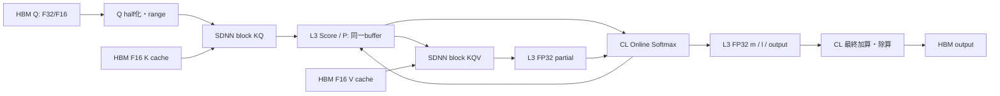

# Kunlun K200 FlashAttention 実装・実機評価レポート

開発日: 2026-10-26 JST。ライブラリ0.7.0、作業ブランチ `codex/k200-flash-attention-20261026`。既定の独立KQ/Softmax/KQV経路を保持した、明示的に有効化する実装。この文書は実装評価終了時点の測定記録である。

この保存版はソースと集計値をリポジトリに収録するもの。文中の配布物・rawログ・compiled binary・snapshotへの参照は、実機結果ディレクトリの開発成果物を指す。SDK、モデル重み、raw logits、配布archiveはGitへ追加していない。

## 1. 結果と採用判断

**SDNN KQ → CL Online Softmax → SDNN KQVをKVブロック単位で実行するFlashAttentionが、両PD・両モデルで動作した。Score/確率/途中の出力を共有L3に保持し、これらの中間値をHBMへ戻さない。** 1個の混合カーネルではなく、異種エンジンの専用カーネルをdefault streamで順次実行する構成である。

TinyLlama 1.1B、共通KV更新条件でのPP2048/TG@2048 token/s改善率: PD0: -0.2% / +13.8%, PD1: +3.9% / +10.1%。
Llama 2 7B、共通KV更新条件でのPP2048/TG@2048 token/s改善率: PD0: +8.3% / +19.5%, PD1: +8.7% / +20.3%。

TinyLlamaのPD0・PP2048はほぼ同等であり、全shapeで高速化したとは言えない。7BではPPとTGの双方に明確な改善が残った。従来KV更新の最適化による効果とFlashAttention自体の効果を、別の対照群で分離した。

固定1024 token・1020評価位置のperplexityは、TinyLlama 11.152391→11.124671、7B 8.364274→8.345946。限定コーパスでは悪化しなかったが、logitsは旧SDNNとビット一致しない。大規模な品質改善を主張する結果ではない。

旧44カーネルのbinは、既存SDNN/高速Softmax/前処理を含め全てSHA256一致。新規6カーネルを追加し、合計50。Q4 GEMM/GEMV、RoPE、SwiGLUの演算方式は変更していない。新KV writerも別カーネルと設定で分離し、旧writerを残した。

## 2. ハードウェア調査と中間データ共有

実機はKL1/K200、XRE/driver 4.33、XTDK 2.7.98.2、既設firmware、900 MHz。後継XPUの仕様を混用していない。既存のArchitecture/SDNN・MAC・Cluster・NoCレポート、実機SDKの `sdcdnn_header.h` / `cluster_header.h`、既存SDNN Attentionを確認した。

| 領域・エンジン | 構成・利用上の制約 |
| --- | --- |
| SDNN / 通常CL | 各PDにSDNN 4基とCL 4個。通常CLは16 core/cluster、FP32 SIMDは8 lane |
| L1D / L1W / L1E | 1 SDNNあたり512 KiB / 2 MiB / 256 KiB。MAC入力・重み・可視FP32結果の専用領域 |
| L2_0 / L2_1 | 各128 KiB。2入力DMA/DSのステージング。F16/F32からINT16変換に使用 |
| L2E / L2R | 各128 KiB。EWとRSを経由してMAC結果をDMAOUTへ渡す |
| CL LM / SM | 1 coreのLMは16 KiB級でstackを共用。今回のOnline kernel frameは約11.6 KiBで上限16256 bytes内。SMは採用していない |
| 共有L3 | 16 MiB/PD、明示確保するscratchpad。CLとSDNNの双方がグローバルアドレスとして利用可能 |
| HBM | Q/K/Vと最終出力を保持。L3確保不能時の限定workspace fallbackも用意 |

**SDNNのL1E/L2を通常CLから直接読む公開APIは利用していない。実証したHBMを介さない受け渡しは共有L3経由である。** `XPU_MEM_L3` で確保した領域へSDNNがScoreを書き、CLが読み替えた確率をSDNNが読み、FP64参照と比較した。最初のD64/S256/M32/H4試験、両PDの代表shape、異なる入力への再計算まで通った。L3の実確保は監査でも確認した。物理的に別の非公開経路が存在しないと断定するものではない。

MACはIEEE FP16を直接乗算するモードではなく、入力DMAでFP16またはFP32を対称INT16へ変換して演算する。L1E出力と可視累積はFP32、ブロック間の最大値・分母・出力累積もCLのFP32で処理する。MAC内部の全演算段階がIEEE FP32であることや物理accumulator幅は、この試験からは確定していない。

## 3. アルゴリズムと専用カーネル



各行について、新ブロックのscoreをx、過去の最大値・分母・未正規化出力をm,l,oとして、`m_new=max(m,max(x))`、`alpha=exp(m-m_new)`、`p=exp(x-m_new)`、`l_new=alpha*l+sum(p)`、`o_new=alpha*o+p*V_block` を計算する。全mask行は分母0・出力0とし、`-inf - -inf` をexpへ渡さない。

実装では前ブロックのKQV結果を次のOnline kernelで取り込んでから再スケールし、最後だけ最終加算・除算を起動する。追加の出力加算kernelを各ブロックへ挿入していない。

| ソース | 処理 |
| --- | --- |
| kunlun-flash-kq.xpu | 32-key weight tileをL1Wに置き、query tileをL1Dへ供給。FP32 scoreをL3へ出力 |
| kunlun-flash-online.xpu | 1行/core。scale、F16/F32 mask、ALiBi、running max/sum/outputを更新。8個のnative expを展開、rescaleにSIMDを使用 |
| kunlun-flash-pv-wide.xpu | Vの全D幅を読み、L1Wで全featureへ確率を再利用。入力L2の128 KiBを超えないようVを分割転送 |
| kunlun-flash-pv.xpu | 32-feature版。比較・手動fallback用として維持 |
| kunlun-flash-range.xpu | SDNNの完了済み1D DMA findmaxを使ってQ tileの最大絶対値を算出 |
| kunlun-flash-set-rows.xpu | FA用の非転置KV配置でrow/featureを並列化する任意の補助kernel |
| src/flash.inc | 契約検査、buffer寿命、SDK cast/findmax、L3/HBM確保、非同期enqueueと最終wait |

QはFP16へ丸める。K/Vは物理spanが論理要素数×2なら、head-interleavedなviewでも元のFP16 cacheを直接DMAで読む。外側に穴があるviewだけF16 gatherする。Q/K/Vの全FP32展開は行わない。Qのquery tile既定128は従来32と量子化粒度が異なり、`KUNLUN_FLASH_QUERY_TILE=32` で従来粒度を選択できる。

K/VはAPIごとにSDK findmaxを1回ずつ実行し、全4部分最大値をreduceする。pointer単位のKV/scale cacheは導入していない。Online Softmaxの未正規化pは0〜1なので、P側のcast・findmax・rangeを起動せず、FP32 pを直接DMAのINT16変換へ供給する。これにより確率をF16に一度丸める中間処理もなくなった。

TGのGQAでは共有headをMACの行としてまとめる。Qはheadごとの最大値で別々にDMA変換し、MAC後のCLで個々のQ scaleを戻す。共有headへ単一の大きなQ scaleを強制して、小振幅headを潰す方式にはしていない。P側も共有headを行としてまとめ、同じVをL1Wで再利用する。

全enqueueはdefault stream上で順序付けされ、公開APIは最後のwait後に返る。metadata変更・buffer拡張は完了を待ってから実施する。Q4と共有するL3 poolはruntime mutexで保護し、layerごとに12 MiBずつ確保しない。SDNNとCLの演算を別streamで同時に走らせるoverlapは未実装。

## 4. 候補の比較と採否

| 候補 | 実測と判断 |
| --- | --- |
| CLでpをFP16化 | 不採用。D64/S256/M128/H32で約4.46 ms、旧約2.56 ms。scalar half変換と余分な領域が重かった |
| FP32 pとScoreのL3 alias | 採用。同shape約1.71 ms。PをそのままDMAでINT16へ変換でき、誤差も減った |
| query tile 16/32/64/128 | D128/S512/M128の初期比較で4.66/3.73/3.26/3.07 ms。既定128、精度・shape比較用の小tileも維持 |
| KV block 128/256/512 | D128/S2048/M128の初期F32版で18.58/15.81/14.55 ms。PPは512を選択 |
| 全KVをgather | 不採用。実LLMで余分なcopyを生んだ。compactな物理viewは元cacheを直接参照 |
| FA用KV更新の並列化 | 採用。ただし独立設定。Tiny PP128+512の診断でSET_ROWS合計535.3→48.6 ms。indexを全検査し、重複/非連続ならrow順を保持 |
| TG GQA head行まとめ | 採用。D64/S2048/M1で約0.82 ms、同条件の旧Attention約1.22 ms。head別scaleを保持 |
| V全feature幅のKQV | 採用。D128/S512/M1のnarrow約1.24→wide約0.81 ms、PPでも改善。必要な確率のL3読込はD/32回から1回へ |
| L3 / HBM workspace | 両方動作。採用版D128/S2048/M128はL3 11.339 / HBM 11.999 ms。既定L3、確保不能時はHBM |
| SDK Softmax | 採用しない。今回の経路は検証済みnative expと独自Online更新を使用 |

PV比較の8ログは当時のbenchが既定query tile表示を32に固定していたが、実際のlibrary既定は128である。rawログは変更せず、`metrics.json` / `units.csv` の `query_tile_effective` で明示した。最終benchはAPI統計から実際の値を表示する。

初期F32版はTinyLlamaの通常推論で旧版より遅く、7Bのみ小幅に速かった。初期値を採用結果として報告していない。FA用KV配置の更新コスト、gather、TGのMAC行利用率、細かいV転送を切り分けてから最終構成を評価した。

## 5. Attention単体・同期・転送・workspace

以下はQ F32、K/V F16、head32。D64はHkv4、D128はHkv32。実cacheに近いhead-interleaved入力。API完了までを測定し、warmup1回後の4測定の上側中央値。旧値は独立KQ＋高速Softmax＋KQVの3 API合計で、後段CONTの時間を含まない。新値はcast/gather/range、全ブロック、最終正規化を含む。CPU参照・upload/download・診断同期は計測外。

| PD | D | S | M | 旧 ms | FA ms | 速度比 |
| --- | --- | --- | --- | --- | --- | --- |
| 0 | 128 | 2048 | 1 | 3.437 | 3.103 | 1.11x |
| 0 | 128 | 2048 | 128 | 23.016 | 11.349 | 2.03x |
| 0 | 128 | 256 | 1 | 0.573 | 0.446 | 1.28x |
| 0 | 128 | 256 | 128 | 3.481 | 1.754 | 1.99x |
| 0 | 128 | 4096 | 1 | 6.904 | 6.142 | 1.12x |
| 0 | 128 | 4096 | 128 | 62.350 | 22.012 | 2.83x |
| 0 | 128 | 512 | 1 | 1.035 | 0.824 | 1.26x |
| 0 | 128 | 512 | 128 | 6.327 | 3.004 | 2.11x |
| 0 | 64 | 2048 | 1 | 1.130 | 0.784 | 1.44x |
| 0 | 64 | 2048 | 128 | 19.652 | 8.789 | 2.24x |
| 0 | 64 | 256 | 1 | 0.268 | 0.144 | 1.86x |
| 0 | 64 | 256 | 128 | 2.766 | 1.344 | 2.06x |
| 0 | 64 | 4096 | 1 | 2.493 | 1.552 | 1.61x |
| 0 | 64 | 4096 | 128 | 55.928 | 17.603 | 3.18x |
| 0 | 64 | 512 | 1 | 0.426 | 0.259 | 1.64x |
| 0 | 64 | 512 | 128 | 5.339 | 2.350 | 2.27x |
| 1 | 128 | 2048 | 1 | 3.468 | 3.114 | 1.11x |
| 1 | 128 | 2048 | 128 | 23.261 | 11.454 | 2.03x |
| 1 | 128 | 256 | 1 | 0.589 | 0.455 | 1.29x |
| 1 | 128 | 256 | 128 | 3.515 | 1.757 | 2.00x |
| 1 | 128 | 4096 | 1 | 6.928 | 6.182 | 1.12x |
| 1 | 128 | 4096 | 128 | 62.921 | 22.009 | 2.86x |
| 1 | 128 | 512 | 1 | 1.030 | 0.832 | 1.24x |
| 1 | 128 | 512 | 128 | 6.370 | 2.999 | 2.12x |
| 1 | 64 | 2048 | 1 | 1.255 | 0.774 | 1.62x |
| 1 | 64 | 2048 | 128 | 19.975 | 8.775 | 2.28x |
| 1 | 64 | 256 | 1 | 0.245 | 0.133 | 1.84x |
| 1 | 64 | 256 | 128 | 2.884 | 1.367 | 2.11x |
| 1 | 64 | 4096 | 1 | 2.501 | 1.515 | 1.65x |
| 1 | 64 | 4096 | 128 | 55.909 | 17.508 | 3.19x |
| 1 | 64 | 512 | 1 | 0.453 | 0.252 | 1.80x |
| 1 | 64 | 512 | 128 | 5.318 | 2.354 | 2.26x |

B=1の代表値は採用版構成の測定。後続のbatch反復修正はB=4/KV batch=2で別途検証し、最終ビルドのD128/S2048も再測定した。最終LLMバイナリは両モデル・3 prompt長の保存logitsとビット一致を確認した。

### 段階別診断

各段へ明示waitを追加した別run。warm4回の中央値。合算は通常API時間と同一ではなく、coreの純MAC busy時間でもない。pack/castにはSDK処理、rangeにはK/V findmaxとQ rangeを含む。

| PD / M | pack/cast | range | workspace | KQ | Online | KQV | final |
| --- | --- | --- | --- | --- | --- | --- | --- |
| p0-m1 | 0.0254 | 0.1136 | 0.0021 | 0.4645 | 0.0399 | 0.1991 | 0.0139 |
| p0-m128 | 0.1114 | 0.1445 | 0.0022 | 0.8191 | 1.6211 | 0.3236 | 0.1412 |
| p1-m1 | 0.0259 | 0.1223 | 0.0022 | 0.4768 | 0.0498 | 0.1921 | 0.0148 |
| p1-m128 | 0.1165 | 0.1376 | 0.0023 | 0.8280 | 1.6096 | 0.3122 | 0.1345 |

### warm APIのruntime監査

D128/S2048/M128では旧9 launch/5 waitに対しFA18 launch/1 wait。TGのD64/S2048/M1では旧10 launch/7 waitに対しFA11 launch/1 wait。launch数は必ずしも減らないが、ブロック間のCPU完了待ちをなくした。4 warm APIの監査値を4で割った値で、追加の診断waitはない。明示的なmetadata H2Dと結果D2Hは両方式ともwarm区間0だった。launch引数自体の転送までゼロという意味ではない。

r=M×Hq×B、KV block=bとするとL3は `r*(4*b+8*D+32)` bytes。Score/Pはalias、partialと出力累積が各F32、統計は32-byte record/row。D128/M128/H32/b512で **12.125 MiB**、D64で10.125 MiB。Sを512→4096へ延ばしても、この中間workspaceは増えない。Qのgather/cast、非compact KVのgather、SDK内部scratchは別。

D128/S512/M128/H32では、score/probabilityの1枚が8 MiB。旧経路のscore書込・Softmax read/write・P cast read/half write・P range read・KQVのP再読込の論理payloadは計60 MiBで、L3版ではこの部分のHBMアクセスが0になる。これは演算子ソースから算出した論理byteで、物理HBM transaction counterの実測ではない。Q/K/V、mask、最終出力、launch制御の転送は残る。旧後段CONTが必要とする出力repackもfused output配置で省ける。

### 推論全体のhost転送・HBM予約量

TinyLlama、PP128＋512を各1回、その後TG各7 stepの独立監査。FFN/SwiGLU=CPUなどAttention外の転送も含む。LD_PRELOADで捕捉したruntime memcpyだけを計数し、カーネル内部DMAやmodel初回uploadはこの表へ加えない。通常token/sとは別run。HBM/L3はxpu_mallocで観測した全process予約byteのpeakで、純Attention workspaceではない。

| 方式 | PP H2D MiB | PP D2H MiB | TG H2D MiB | TG D2H MiB | HBM peak MiB | L3 peak MiB |
| --- | --- | --- | --- | --- | --- | --- |
| cpuattn | 419.09 | 977.58 | 9.98 | 707.77 | 623.76 | 1.375 |
| oldkv | 296.34 | 615.47 | 7.68 | 14.17 | 817.57 | 1.375 |
| flash | 294.62 | 588.08 | 7.45 | 13.57 | 689.94 | 10.125 |

CPU AttentionはKVを含むhost/device間の受け渡しが多い。FAの効果を全てMACの演算性能だけに帰属させない。共通のCPU FFN転送はFAでも残る。

## 6. 実LLMの通常性能

TinyLlama 1.1B / Llama 2 7B Q4_0。context capacity4096、batch/ubatch128、同じ2048 token列のprefix、teacher-forced16位置（TGは15 step）。6 CPU threads、`OMP_WAIT_POLICY=PASSIVE`、common Q4=1、RoPE=1、SwiGLU=0、Attention matmul=auto、Softmax=fast、prep=auto。最終FAはquery tile128、wide PV、TG head groupingを有効、KV blockはPP512/TG1024。

全てmodel/context生成時間を除いた完了時間。元SDNNはwarmup1＋3反復、共通KV対照群・最終FA・CPU Attentionはwarmup1＋2反復の中央値。診断callback、state check、TRACE、LD_PRELOADは入っていない。PP2048はM=2048の単一kernelではなく、ubatch128を16回処理した結果。

| model | PD | 方式 | PP128 | PP512 | PP2048 | TG@128 | TG@512 | TG@2048 |
| --- | --- | --- | --- | --- | --- | --- | --- | --- |
| tiny | 0 | CPU Attention | 255.96 | 246.89 | 205.86 | 18.01 | 17.41 | 14.32 |
| tiny | 0 | 旧SDNN | 237.30 | 224.99 | 182.68 | 20.39 | 17.98 | 13.70 |
| tiny | 0 | SDNN+KV並列 | 260.59 | 253.90 | 196.74 | 20.37 | 17.47 | 13.52 |
| tiny | 0 | Flash | 265.16 | 257.85 | 196.38 | 22.03 | 19.95 | 15.39 |
| tiny | 1 | 旧SDNN | 243.00 | 224.64 | 179.20 | 19.44 | 17.81 | 13.18 |
| tiny | 1 | SDNN+KV並列 | 258.15 | 244.49 | 187.97 | 20.38 | 17.65 | 13.91 |
| tiny | 1 | Flash | 264.66 | 253.38 | 195.27 | 22.00 | 19.93 | 15.32 |
| 7b | 0 | CPU Attention | 58.27 | 57.62 | 51.48 | 2.78 | 2.57 | 2.07 |
| 7b | 0 | 旧SDNN | 63.92 | 63.41 | 55.17 | 5.85 | 4.98 | 3.43 |
| 7b | 0 | SDNN+KV並列 | 63.93 | 62.49 | 55.32 | 5.85 | 5.03 | 3.46 |
| 7b | 0 | Flash | 69.08 | 67.63 | 59.90 | 7.10 | 6.02 | 4.14 |
| 7b | 1 | 旧SDNN | 64.21 | 62.76 | 55.05 | 5.55 | 4.86 | 3.39 |
| 7b | 1 | SDNN+KV並列 | 63.73 | 62.26 | 55.01 | 5.66 | 4.92 | 3.41 |
| 7b | 1 | Flash | 68.82 | 67.54 | 59.81 | 6.98 | 5.96 | 4.11 |

CPU Attention列はQ4等をKunlunへoffloadしたままAttentionをCPUに配置した既存モードで、全モデルCPU実行ではない。このモードでは既存設定上RoPEもCPUになる。

| model / PD | PP128 | PP512 | PP2048 | TG@2048 |
| --- | --- | --- | --- | --- |
| tiny / 0 | +1.8% | +1.6% | -0.2% | +13.8% |
| tiny / 1 | +2.5% | +3.6% | +3.9% | +10.1% |
| 7b / 0 | +8.0% | +8.2% | +8.3% | +19.5% |
| 7b / 1 | +8.0% | +8.5% | +8.7% | +20.3% |

上表はKV writerを同じ設定に揃えたFAの改善率。旧KV writer→新writerだけの12組のteacher logitsはSHA一致し、数値結果を変更していない。Tiny PP2048/PD0の-0.2%程度は同等と扱い、有意な改善とはしない。TinyのPPはCPU Attentionに常に勝つわけでもない。7BのPP2048と両モデルの長context TGで優位性を確認できた。TGは15 step×2反復なので、1%級の差の精密な優劣には使わない。

### Layer / Row Split

診断なし、warmup1＋1反復の追加run。共通KV条件、PP512とその後のTG。精密な統計ではないが、今回の比較では両方式とも回帰は観測しなかった。別の32位置評価で全splitのstate restoreも検証した。

| model | split | 旧 PP512 | FA PP512 | 旧 TG@512 | FA TG@512 |
| --- | --- | --- | --- | --- | --- |
| tiny | layer | 245.36 | 264.00 | 17.63 | 18.53 |
| tiny | row | 156.98 | 160.65 | 11.45 | 12.07 |
| 7b | layer | 62.38 | 68.04 | 5.00 | 5.94 |
| 7b | row | 43.16 | 44.97 | 3.84 | 4.40 |

## 7. 数値精度・生成・互換性

合計162件のmode別行列評価がpass。代表32条件はD64/128、S256/512/2048/4096、M1/128、両PD。M33、S288の端数block、F16 Q、stride付きinput/output、GQA、B4/KV batch2の連続group反復、head/batch mask broadcastも検証した。代表的大行列のFP64参照は4 query行を抽出し、M1と小行列は全行。`sampled` 列で区別している。最終追加試験では旧Attentionとの差と有限性は全出力で検査するようbenchも整備した。

追加数値条件のFP64参照に対する最大NMSEは 5.38173e-08、最大絶対誤差は 5.99253e-05。参照はF16 K/Vと、原則FP16へ丸めたQをF64で積和・Softmaxしたもの。`full_q=1` の乱数・振幅差の大きいTG試験では元F32 Qを参照し、Q丸めを含む誤差も評価した。CPU参照誤差と旧SDNNとの差は `units.csv` に分けて保存した。

全mask行=0、maskなし（未使用descriptorを異常値にした試験を含む）、F16/F32 additive mask、ALiBi、scale=0/負値、大きな共通mask値、零/微小Q、外れ値、異なるhead振幅、ランダム入力、非連続viewを確認。Q/K/V/maskの全byteと出力paddingのguardを検査した。入力を同じpointer上で変更して再実行する試験でも再計算され、KVは不変だった。

INT16入力streamの全量dumpはしていない。全4 maxのreduce、同じFP16変換、元cacheの不変性、CPU FP64・旧SDNN比較を検証したもので、全入力範囲で量子化の飽和/丸め誤差がゼロという主張ではない。FP16表現範囲外のQ、NaN/+Inf入力は保証していない。既存のINT16 global K/V scaleの外れ値感度も残る。

### コーパス評価

**corpus-tiny-cpuattn**

```text
CORPUS input_tokens=1024 scored=1020 context=256 batch=128 mean_nll=2.41302564282 perplexity=11.1676995491
```

**corpus-tiny-oldkv**

```text
QUALITY reference=0 positions=1020 nmse=0.00233188141618 mean_KL=0.0115892528268 max_KL=0.444695962332 max_abs=5.30684149265 greedy_equal=977
CORPUS input_tokens=1024 scored=1020 context=256 batch=128 mean_nll=2.41165393198 perplexity=11.1523911962
```

**corpus-tiny-flash**

```text
QUALITY reference=0 positions=1020 nmse=0.00226732909054 mean_KL=0.0106232973306 max_KL=0.262890877349 max_abs=3.1533408165 greedy_equal=968
QUALITY reference=1 positions=1020 nmse=0.00235080948668 mean_KL=0.0110532692832 max_KL=0.19227025116 max_abs=3.9464224577 greedy_equal=973
CORPUS input_tokens=1024 scored=1020 context=256 batch=128 mean_nll=2.40916528227 perplexity=11.1246713081
```

**corpus-7b-cpuattn**

```text
CORPUS input_tokens=1024 scored=1020 context=256 batch=128 mean_nll=2.12232518596 perplexity=8.35053147013
```

**corpus-7b-oldkv**

```text
QUALITY reference=0 positions=1020 nmse=0.00669191446368 mean_KL=0.0103399024465 max_KL=1.39331264405 max_abs=5.49015307426 greedy_equal=981
CORPUS input_tokens=1024 scored=1020 context=256 batch=128 mean_nll=2.1239695518 perplexity=8.36427409473
```

**corpus-7b-flash**

```text
QUALITY reference=0 positions=1020 nmse=0.00668308360361 mean_KL=0.00835000147539 max_KL=0.206812471099 max_abs=5.62077140808 greedy_equal=976
QUALITY reference=1 positions=1020 nmse=0.00613515166406 mean_KL=0.00957425453486 max_KL=0.693960308991 max_abs=5.03655427694 greedy_equal=963
CORPUS input_tokens=1024 scored=1020 context=256 batch=128 mean_nll=2.12177597136 perplexity=8.34594649553
```

Flashのreference0は旧SDNN、reference1はCPU Attention。1020評価位置・context256・batch128の固定subsetである。PPLは両モデルとも低下したが、greedy一致数等は全指標が改善するわけではない。量子化・演算順序によるlogits差を隠さず保存した。大規模corpusや人手品質評価は未実施。最終修正後の両corpus出力は評価済みFlash出力とSHA一致し、最終バイナリのPP128/512/2048後のteacher logitsも保存済み結果と全てビット一致した。

短い自由生成32 token、2048 prompt後の自由生成64 token、none/layer/rowでのteacher-forced32位置を両モデル・両方式で実行。全て有限・正常完了。state restore後の次logitsは各mode内でビット一致した。FA on/offでllama.cppのV cache配置が異なるため、modeを跨ぐstate互換は保証しない。旧Attention・RoPEのgraph試験、両PDのSwiGLU、SwiGLU有効時の実LLM、Q4 layout/invalid argument契約もpass。KV writerは両PDで32条件（F16/F32 source、I32/I64 index、端数幅、重複index等）をCPU期待byteと比較した。

## 8. 制約・運用記録

未対応: sinks、logit soft cap、D64/128以外、Sの32未満の端数、内側非連続view、workspace/SRAM制約を超えるshape。API上限はS16384だが今回の実機行列評価は4096まで、LLMの実使用は2048+64まで。未対応のfused nodeはGGML CPU配置へ戻る。旧XPU3演算へ自動graph展開する機能はなく、`-fa off` で明示的に旧経路へ戻す。旧long-context GQA KQ GEMVのCL fallbackは一切変更していない。

別streamのSDNN/CL overlap、L1E→CL直接参照、Flash-Decoding型KV分割reduction、純MAC busy時間・物理HBM transaction計測、全量INT16 dump、modeを跨ぐstate restoreは未実装/未検証。性能比較用narrow PV、HBM scratch、query/KV tile設定は維持した。

開始時は両repo cleanで、公開済み0.6.3のHEADをsnapshotへ保存してからbranch作成。未コミットの過去成果を破棄していない。今回のcard resetは **0回**。最高温度61℃、観測周波数[900.0] MHz、最終両PDはRUNNING/no error。SDK/driver/FW/clockは変更していない。

試験途中の非正常終了は、初期FP16確率版のL3 budget超過を事前契約で拒否したものと、既存graphテストへ有効化envを渡し忘れたassert。いずれもXPU障害ではなく、state/errinfo確認後に設定を修正して再実行した。失敗ログと理由は残し、resetして隠していない。初期のhost buildエラーも修正ログを保存した。

## 9. 残存ボトルネックと次の候補

1. **KQのQ再読込削減**。現在は32-key tileごとにQを供給する。KV block全体をL1Wに置き、QをL1Dへ保持して複数出力列を計算する構成が次の候補。
2. **Online Softmax**。mask変換、max/sum、共有SFUのexp、出力rescaleが残る。今回の専用KQV高速化後はこのCL段の比率が高い。
3. **実際のengine overlap**。block256のdouble bufferなら16 MiB内へ収まる構成を検討できる。別stream/eventの依存とworkspace寿命を先に最小試験する。
4. **Flash-Decoding**。TGのKV block並列化と部分m/l/oのreductionで、少ないquery/head数でもCL/SDNNの全clusterを使う。
5. **量子化粒度**。K/Vをhead別・block別にscale化し、global scaleの外れ値感度を低減する。query tile変更による精度差も大規模corpusで評価する。
6. **推論全体**。今回揃えた設定ではCPU FFN転送、Q4、KV更新、launchが残る。Tiny PPがCPU Attentionや共通KV対照群へ常に勝たない理由を、Attention外の時間も含めて扱う。

## 10. ソースと再現

実機workspace: `/home/unagidojyou/kunlun-k200`。standalone buildは `build/flash-lib`、llama.cppは `build/flash-llama`。既存の `build/sdnn-preprocess-*` は変更していない。sourceは同workspaceの両repo、今回だけのpatchは `library-flash-only.patch` / `llama-flash-only.patch`。snapshotにapplyして全変更ファイルのSHA一致を確認した。

```bash
export XRE=$PWD/external/xre XDNN=$PWD/external/xdnn XTDK_DIR=$PWD/external/xtdk
export LD_LIBRARY_PATH=$XRE/lib64:$XDNN/so:$XTDK_DIR/shlib
cmake -S repos/llama.cpp -B build/flash-llama -G Ninja -DGGML_KUNLUN=ON -DCMAKE_BUILD_TYPE=Release -DLLAMA_BUILD_EXAMPLES=ON
cmake --build build/flash-llama -j4 --target kunlun-llm-smoke kunlun-quality-eval
GGML_KUNLUN_ATTENTION=1 GGML_KUNLUN_FLASH=1 KUNLUN_FLASH_KV=1 K200_FLASH=1 KUNLUN_ATTENTION_MATMUL=auto KUNLUN_ATTENTION_SOFTMAX=fast KUNLUN_ATTENTION_PREP=auto build/flash-llama/bin/kunlun-llm-smoke models/tinyllama-q4_0.gguf none 16 /tmp/fa-logits.bin 0
```

正確な測定条件・token列・guardを含む再現は同梱 `reproduce.py` を使う。`--pd 0/1` が代表行列、`--llm tiny/7b` が共通KVの旧/FA通常推論比較。一般のllama-cli/benchは `-fa on`、test toolだけ `K200_FLASH=1`。旧経路はFAを無効化する。詳細契約と全設定は `source/library/docs/flash-attention.md`。

`metrics.json`、`performance.csv`、`units.csv`、生ログと実行env、元HEAD、最終source SHA、compiled kernels/library、実験版、再現用入力を同梱する。SDK・モデル・SSH秘密鍵・巨大raw logitsは配布物に含めない。raw logitsは実機結果ディレクトリに残し、比較結果とSHAを保存する。
