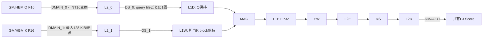

# Kunlun K200 FlashAttention SDNN KQ再利用最適化（0.7.2）

評価日: 2026-10-26 JST。基準: 未コミット変更を含むFlashAttention 0.7.1の保存snapshot。実機: 192.168.50.112、K200/KL1、両PD、XRE 4.33、XTDK 2.7.98.2。

## 結果と採用判断

K blockをL1Wに保持し、量子化済みQをL1Dから複数key tileへ再利用するKQを実装した。32-key出力を維持した版でも改善し、EW/RS/出力DMAの集約でさらに高速化した。KQ出力・Attention出力・LLM logitsは検証範囲で0.7.1とビット一致した。

KQ単体は代表PPで数倍、TGでさらに大きく短縮する。一方、実LLMのPP改善は小さい。初回PP2048はTinyで約3〜5%、7Bで約1.6〜2.8%、TG@2048は両モデルとも概ね2割改善した。短いPPでは初回と追試の変動が改善幅より大きい場合があり、一律の大幅改善とはしない。以下に全測定と制約を示す。

## 1. 従来の重複読み込みと実際の階層

旧`kunlun-flash-kq.xpu`はtaskを`batch × KV head × 32-key tile`で分割する。Kの32キーをL1Wへ置き、そのtileをGQAのquery headとquery tileへ再利用する。一方Qは内側で毎回`load(..., port=0)`される。

このloadは単なるMAC入力の再指定ではない。`DMAIN_0: DMA_GM|FP16 → DMA_L2_0|INT16`、`DS_0: L2_0 → L1D`を実行する。PP count512では同じQを16回、TG count1024では32回、GMから再要求し、INT16変換とDS配置も繰り返す。現LLMのFP32 Q cast先は通常のHBM Bufferで、Qを一度L3に置く段階はない。既存F16 Qなら渡されたGM viewを直接読む。物理HBM bus量を測るカウンタは使用していないため、以下のbyteはDMA設定から求めた論理転送量である。

生成ISAでは`l2_mov_cfg`/`l2_mov_2d_cfg`/`l2_mov`と`shuffle_batch`が旧key task内にある。新kernelではQ転送がkey出力ループ外に移り、そのループのMAC入力Aは同じL1D offsetを参照する。実行時カウンタと全keyの出力一致でも再利用を確認した。MACが演算上必要とするL1D→MAC読み込みまで削除したという意味ではない。

## 2. SRAM・量子化・4 SDNNの制約

SDK定数と既存の実機SRAM/MAC試験により、1 SDNNはL1D 512 KiB、L1W 2 MiB、L1E 256 KiB、L2_0/L2_1・L2E・L2R各128 KiB。各領域は独立しており、数値offset 0を同時に使用できる。制御coreのLM/stackとは別である。

F16→INT16は従来どおり入力DMAが行う。KのSDK findmaxの4つの部分最大値をすべてreduceし、Qの既存tile/head別rangeを使う。dequant係数`Kpeak*Qpeak/(32767²)`、MACのINT16形式、可視FP32出力を維持した。TG GQAは各headを固有Qpeakで変換し、MAC側Qpeak=1、CL側でheadごとのpeakを戻す従来仕様を維持。物理MAC内部の部分和形式を新たに断定するものではない。

4 SDNNのcore0が各MAC arrayを制御する。新taskは基本的にbatch/KV head単位。`parts=min(count/32,ceil(4/(B*HK)))`で少KV head時だけkey範囲を分け、4 SDNNを使う。Kは各担当範囲全体をL1Wに保持し、全GQA head/query tileに使う。B*HK=3などの非整列分担では完全な負荷均等を保証しない。GQAの共有Kをheadごとに再ロードする構成にはしていない。

K count1024/D128は256 KiBでL1Wに入るが、L2_1は128 KiBなので512キーずつ2回DMAし、L1Wの別offsetへDS配置する。Qはquery tile単位でL1D offset0に置き、MAC/EW/RS/DMAOUT完了まで上書きしない。次query/headで更新する。L1DをKV block間まで保持する構成ではなく、KQVが同じSDNN領域を使う既存契約を維持する。

## 3. 比較した方式と実装

| 方式 | 変更 | 判断 |
| --- | --- | --- |
| legacy | 32-keyごとにK/Q供給・2 MAC・EW/RS/出力 | 0.7.1比較/fallbackとして未変更で保存 |
| reuse32 | K全体をL1W、QをL1Dへ一度配置。出力32キー維持 | 再利用自体の改善を確認、比較用 |
| reuse128 | 再利用＋最大128-key出力をまとめる | さらに短縮、比較用 |
| reuse256 | 再利用＋最大256-key出力 | PPで有効、比較用 |
| reuse1024 | 最大1024-key、ただし各SRAM容量で制限 | PP/TG共通の採用kernel |

新`kunlun-flash-kq-reuse1024.xpu`は`flash-kq-device.h`を使用する。出力幅は`min(1024, floor(32768/rows/32)*32, 残りkey数)`。PP rows128では256-key/128 KiB、TGでは通常1024-keyをまとめる。MACは依然1命令16キーであり、内積Dの順序や量子化tileを変更しない。まとめるのは設定・fence・EW・RS・出力DMA。Qtile128、PP block512、TG block1024（既存例外あり）は固定した。

SRAM使用量/SDNN（B=1,Hq32、default shape。L2_0/1の使用量は各入力DMAのINT16 payloadで各128 KiB以内）:

| shape | L1D使用 KiB（同一） | L1W使用 旧→新 KiB | L1E/L2E/L2R使用 旧→新 KiB |
| --- | --- | --- | --- |
| Tiny PP | 16 | 4 → 64 | 16 → 128 |
| 7B PP | 32 | 8 → 128 | 16 → 128 |
| Tiny TG | 2 | 4 → 128 | 1 → 32 |
| 7B TG | 4 | 8 → 256 | 0.125 → 4 |

制御LM frameは352→384 byte、compiler上限16,256 byte以内。kernel binaryは2,652→3,172 byte、code allocationは3,072→3,584 byte（+512 byte/loaded program）。新しいHBM中間データbufferは追加せず、L3 workspaceも不変。D128/M128/H32/block512では12.125 MiBである。

DMA double bufferingやMAC/転送pipelineは今回採用していない。既存fenceを保つ直列のエンジン制御で、重複転送と小要求を減らす方式を先に検証した。新方式が絶対的な最適解という主張はしない。

## 4. 転送回数・論理byte・命令数

PD0の専用診断で実行時カウントした1 KQ呼出し全4 SDNNの合計。PP count512、TG count1024、Hq32:

| shape | Q DMA要求 | K DMA要求 | Q DS batch | K DS batch | MAC命令（両版） | 出力DMA |
| --- | --- | --- | --- | --- | --- | --- |
| Tiny PP | 512 → 32 | 64 → 4 | 4096 → 256 | 128 → 128 | 1024 | 512 → 64 |
| 7B PP | 512 → 32 | 512 → 32 | 4096 → 256 | 1024 → 1024 | 1024 | 512 → 64 |
| Tiny TG | 1024 → 32 | 128 → 4 | 128 → 4 | 256 → 256 | 256 | 128 → 4 |
| 7B TG | 1024 → 32 | 1024 → 64 | 1024 → 32 | 2048 → 2048 | 2048 | 1024 → 32 |

入力GM論理byteとL3出力:

| shape | Q GM入力 旧→新 MiB | K GM入力 旧→新 MiB | Score出力 MiB（同一） |
| --- | --- | --- | --- |
| Tiny PP | 8.000000 → 0.500000 | 0.250000 → 0.250000 | 8.000000 |
| 7B PP | 16.000000 → 1.000000 | 4.000000 → 4.000000 | 8.000000 |
| Tiny TG | 0.125000 → 0.003906 | 0.500000 → 0.500000 | 0.125000 |
| 7B TG | 0.250000 → 0.007812 | 8.000000 → 8.000000 | 0.125000 |

QのGM要求はPPで16分の1、TGで32分の1。Kのbyte量とDS batch数は同じで、DMA要求数と設定/fence回数を減らす。特に7B TGは元々K byteが支配的で、Q byte削減だけでは高速化を説明できない。多数の小DMA・range load・engine制御の削減が大きい。query/head/batch broadcastの条件次第でparts分のQ再転送は残る。B方向の共有KVを別batch間で保持する実装も行っていない。

## 5. KQ単体・段階別・Flash API

単体は入力・scaleを計時前に配置し、1 KQ launch＋completion waitを13回（1 warmup＋12測定）、上側中央値。下記のS_source=2048ではPPの最後の512キー、TGの最後の1024キーを処理する。context全体を1回で計算した時間ではない。enqueueと最小値は[kq-units.csv](kq-units.csv)。

| PD | D | M | HK/Hq=32 | count | 旧 KQ ms | 新 KQ ms | 速度比 |
| --- | --- | --- | --- | --- | --- | --- | --- |
| 0 | 64 | 128 | 4 | 512 | 0.533692 | 0.213607 | 2.50x |
| 0 | 128 | 128 | 32 | 512 | 0.741006 | 0.290421 | 2.55x |
| 0 | 64 | 1 | 4 | 1024 | 0.311833 | 0.053109 | 5.87x |
| 0 | 128 | 1 | 32 | 1024 | 0.761857 | 0.208179 | 3.66x |
| 1 | 64 | 128 | 4 | 512 | 0.543835 | 0.218155 | 2.49x |
| 1 | 128 | 128 | 32 | 512 | 0.741776 | 0.293567 | 2.53x |
| 1 | 64 | 1 | 4 | 1024 | 0.307455 | 0.053555 | 5.74x |
| 1 | 128 | 1 | 32 | 1024 | 0.774038 | 0.211695 | 3.66x |

専用`get_clock()`診断のPD0/D128/HK32、各SDNN平均ms。MAC列は設定・発行・既存xfence待ち込み、DMA列も変換/待ち込みであり、純演算busy cycleや待ちだけを独立測定したものではない。

| PD0/D128/HK32 | PP旧 ms | PP新 ms | TG旧 ms | TG新 ms |
| --- | --- | --- | --- | --- |
| Q DMA/変換/待機 | 0.190920 | 0.011320 | 0.100427 | 0.003198 |
| Q DS/待機 | 0.085503 | 0.005272 | 0.039592 | 0.001166 |
| K DMA/変換/待機 | 0.084942 | 0.052957 | 0.175401 | 0.092538 |
| K DS/待機 | 0.028463 | 0.019673 | 0.056926 | 0.039346 |
| MAC設定/発行/待機 | 0.053358 | 0.040803 | 0.032188 | 0.007136 |
| EW/待機 | 0.050650 | 0.038117 | 0.029055 | 0.001424 |
| RS/待機 | 0.043256 | 0.037478 | 0.014548 | 0.007930 |
| 出力DMA/待機 | 0.059241 | 0.039231 | 0.046169 | 0.001978 |
| metadata/制御等 | 0.147473 | 0.013100 | 0.290976 | 0.013558 |
| kernel合計 | 0.743805 | 0.257952 | 0.785282 | 0.168273 |

診断は計時・カウンタ・64 byte/SDNNの出力を追加するため、通常KQ時間として使用しない。4 SDNNの実行が重なるので、全SDNNの時間を加算してwall timeにはしない。新TGではK DMA/DSの比率が高くなり、PPでも残存K/Score帯域とMAC処理が相対的に大きい。詳細は[stages.csv](stages.csv)。

Flash APIはcast/gather、findmax/range、workspace/metadata、全KV blockのKQ/Online Softmax/KQV、最終waitを含む。warmup1＋4回の上側中央値。通常の追加診断waitなし:

| shape | PD | S | M | HK | 旧 API ms | 新 API ms | 速度比 |
| --- | --- | --- | --- | --- | --- | --- | --- |
| Tiny PP | 0 | 2048 | 128 | 4 | 7.838499 | 6.584620 | 1.19x |
| Tiny TG | 0 | 2048 | 1 | 4 | 0.785292 | 0.273451 | 2.87x |
| 7B PP | 0 | 2048 | 128 | 32 | 9.534954 | 7.728641 | 1.23x |
| 7B TG | 0 | 2048 | 1 | 32 | 2.387333 | 1.281586 | 1.86x |
| D128 GQA PP/S4096 | 1 | 4096 | 128 | 8 | 17.013601 | 14.011148 | 1.21x |

公開API、config ABI、Score/PのL3 alias、acc/partial/stats、default stream、1回の最終waitは同一。warm時のlaunch数は変えていない。D128/S2048/M128の例は既存pre処理5＋4block×3＋final=18 launch/1 completion waitの構成を保つ（内部SDNN命令数の削減とは別）。cold時のprogram load/metadata更新waitは従来どおり存在する。

## 6. LLM PP/TGとPD差

TinyLlama 1.1B/Llama 2 7Bの既存Q4_0 GGUF、Single PD、CPU threads6、context4096、batch/ubatch128。同じprompt/teacher token列、Online=auto（0.7.1の順序保持版）、KV writer=1、Q4 common=1、RoPE=1、SwiGLU=0等を揃えた。block/qt/PV/GQA量子化条件はdefault固定。TRACE、CHECK_STATE、preload auditは通常測定に含めない。newは`KUNLUN_FLASH_KQ=reuse1024`、oldはlegacyで測り、採用後のautoが同じbinaryを選ぶことを確認した。

初回: warmup1＋2反復、各反復token/sの中央値。TG@prefixはそのprefixからteacher-forced 15 stepの合計速度。PD0は旧→新、PD1は新→旧。

| model | PD | prefix | PP旧→新 token/s | PP改善 | TG旧→新 token/s | TG改善 |
| --- | --- | --- | --- | --- | --- | --- |
| 7b | 0 | 128 | 71.10 → 70.65 | -0.63% | 7.000 → 7.234 | +3.34% |
| 7b | 0 | 512 | 70.94 → 70.20 | -1.04% | 5.882 → 6.541 | +11.21% |
| 7b | 0 | 2048 | 65.52 → 67.36 | +2.80% | 4.130 → 4.953 | +19.95% |
| 7b | 1 | 128 | 70.60 → 71.63 | +1.46% | 7.068 → 7.141 | +1.02% |
| 7b | 1 | 512 | 70.13 → 70.96 | +1.19% | 6.056 → 6.624 | +9.38% |
| 7b | 1 | 2048 | 65.82 → 66.85 | +1.58% | 4.191 → 5.100 | +21.69% |
| tiny | 0 | 128 | 281.36 → 297.91 | +5.88% | 21.932 → 21.978 | +0.21% |
| tiny | 0 | 512 | 276.74 → 293.33 | +6.00% | 20.172 → 20.446 | +1.36% |
| tiny | 0 | 2048 | 242.57 → 255.12 | +5.17% | 15.818 → 19.111 | +20.82% |
| tiny | 1 | 128 | 283.11 → 284.78 | +0.59% | 22.011 → 23.048 | +4.71% |
| tiny | 1 | 512 | 277.69 → 281.26 | +1.29% | 20.040 → 21.966 | +9.61% |
| tiny | 1 | 2048 | 243.53 → 250.77 | +2.97% | 16.046 → 19.978 | +24.51% |

改善幅の小さいPPを検証するため、順序を反転してwarmup1＋3反復を追加した。初回を置き換えず別系列として全件保存:

| model | PD | prefix | PP旧→新 token/s | PP改善 | TG旧→新 token/s | TG改善 |
| --- | --- | --- | --- | --- | --- | --- |
| 7b | 0 | 128 | 70.42 → 70.62 | +0.28% | 6.991 → 7.224 | +3.33% |
| 7b | 0 | 512 | 69.78 → 70.15 | +0.54% | 5.973 → 6.494 | +8.72% |
| 7b | 1 | 128 | 70.60 → 71.18 | +0.82% | 7.083 → 7.163 | +1.12% |
| 7b | 1 | 512 | 70.35 → 70.38 | +0.04% | 5.981 → 6.619 | +10.66% |
| tiny | 0 | 128 | 280.96 → 283.36 | +0.85% | 21.585 → 22.689 | +5.11% |
| tiny | 0 | 512 | 279.02 → 279.66 | +0.23% | 19.946 → 21.967 | +10.13% |
| tiny | 0 | 2048 | 242.75 → 253.05 | +4.24% | 15.709 → 19.678 | +25.27% |
| tiny | 1 | 128 | 281.74 → 286.08 | +1.54% | 22.162 → 22.621 | +2.07% |
| tiny | 1 | 512 | 277.58 → 280.09 | +0.91% | 20.337 → 22.157 | +8.95% |
| tiny | 1 | 2048 | 244.81 → 256.08 | +4.61% | 15.728 → 18.639 | +18.51% |

初回7B/PD0のPP128/512は−0.63/−1.04%だったが、追試は+0.28/+0.54%。Tiny/PD0の初回短PP約6%は追試で約0.2〜0.9%に縮小した。短PPの効果は小さく実行間変動が残るため、有意な一律高速化とは結論しない。原因を温度や特定エンジンへ断定する追加証拠もない。

長PPは数%の改善、長context TGは概ね2割改善し、KQ単体の倍率がLLM全体の倍率にはならない。Online Softmax/KQV/前処理、Q4/FFN、host/launch等が残る。[performance.csv](performance.csv)のmin/max、[trials.csv](trials.csv)の全反復と[performance-comparison.csv](performance-comparison.csv)を併せて確認できる。

## 7. 精度・互換性

正常/端数/stride/GQA/batch broadcast/外れ値/zero/tiny/head別scale等のKQ測定304行で旧raw Scoreと全要素ビット一致。CPU FP64参照の最大NMSE 8.40306e-09、最大絶対誤差 2.54981（大振幅の外れ値を含む）。TG GQAのraw Score参照はhead別に正規化したQであり、CLがQpeakを復元する前の値。旧KQとの差は0で、INT16/FP16由来の既存誤差を増やしていない。

Flash API比較は代表64＋互換性38＋小sequence24＋最終auto/特殊条件を含め151件。CPU FP64はPPでは4query/全head、小形状は全行、旧版比較は全出力。FP16 Q参照に加え元FP32 Qのcast丸め込み4試験も実施。全体の最大NMSE 5.74004e-08、最大絶対誤差 3.51313e-05、旧APIとの差は0。F16/F32 mask、causal/全mask、ALiBi、GQA無効、3 KV heads、M17/S544、block1024/M64、qt16、KV更新と入力不変性/guardを通過。

両モデルの1024 token corpus（1020位置）は0.7.1と全logitsがビット一致し、最終auto buildでも再確認した。NMSE/KL/max absの追加差は全て0。Tiny perplexity=11.1246713081、7B=8.34594649553で不変。CPU Attentionとの差は0.7.1由来の量子化・経路差を含み、今回の増分はない。[final-corpus-quality.json](final-corpus-quality.json)。

通常性能・追試のlogits、両モデルSingle/Layer/Rowのprefix128/512後32位置、短文32 token/長prefix2048後64 tokenのgreedy生成は一致。全state restore試験の次logitsも一致した。FP16 KVの更新・再利用・read-only不変性を確認。非FA stateとの相互変換は対象外。Attention/RoPE/SwiGLUの両PD回帰、Flash/Attention/Q4 layout contractを通過。[compat-final.json](compat-final.json)。

## 8. 採用・fallback・保存

0.7.2で`KUNLUN_FLASH_KQ=auto`（未設定も同じ）を追加。各SDNN partに複数32-key tileがありQを再利用できる場合は新KQ、`count/32<=parts`相当の短blockでは旧KQを選ぶ。実装の判定はAPIのblockで行い、最終端数blockだけに別programを追加loadしない。`legacy`で0.7.1へ、`reuse1024`で新kernelを明示指定でき、不明値はlegacy。S32やHK1/S128等では新方式に利点がなく悪化した場合もあったため、この保守的dispatchを採用し実経路も検証した。

旧KQを含む0.7.1製品51 kernel binaryは両buildでSHA256一致。Online Softmax、KQV、KV writer、Q4、RoPE、SwiGLUは変更していない。既存の非FA Attention `auto/sdnn/cl`と長context GQA KQ GEMV fallbackもそのまま。API/graph構築の変更はない。

開始時の両repo状態・tar/patch・51 kernel基準を保存し、`codex/k200-flash-kq-20261026` branchで既存未コミット0.7.1を保持した。基準Git HEADはlibrary780fb69、llama.cpp736fad5だが、評価基準はそのHEADに未コミット0.7.1を加えたsnapshotである。新buildは`build/flash-kq-lib`/`flash-kq-llama`、旧`flash-online-lib`/`flash-online-llama`は保持。

結果は実機`/home/unagidojyou/kunlun-k200/results/flash-kq-20261026`。ホスト変数名の衝突によるbuild errorは修正して再検証した。デバイスerror/hang/リセットは0、最終両PD RUNNING/no error。[final-verification.json](final-verification.json)。今回commit/pushは行っていない。ソース・通常/診断ログ・assembly・再現script・token列、0.7.1 snapshotからの差分を成果物へ保存した。

## 9. 残存ボトルネック

1. QはKV blockごとには再ロードする。KQVがL1Dを使うため、kernel間をまたぐQ保持には別offsetの所有権・寿命・SDKのSRAM保持検証が必要。
2. Kのbyteは不変で、特に7B TGの支配項。K/DS/Scoreの帯域、少KV head時の分担、head/batch間再利用をさらに調べる余地がある。
3. DMA/DS/MACは既存fenceで直列制御。独立bankでの二重bufferとengine間overlapは今後の候補であり、今回達成した性能として扱わない。
4. Online SoftmaxとL3 Score/Pアクセスは不変。SDNN/CL pipeline化やFlash-Decodingは別段階に残す。
5. 内部query tile変更はscale粒度を変える。qt sweepは各設定内の新旧比較であり、default128とのLLM品質一致を保証しない。高速化目的で量子化や加算順序を変更しない方針を維持した。
6. LLMはprefix2048＋64生成、単体/APIはS4096まで。より長いcontext・多様なモデル/大量batch、短PPの統計的性能保証は今後の検証範囲。

再現: [REPRODUCE.ja.md](REPRODUCE.ja.md)。
